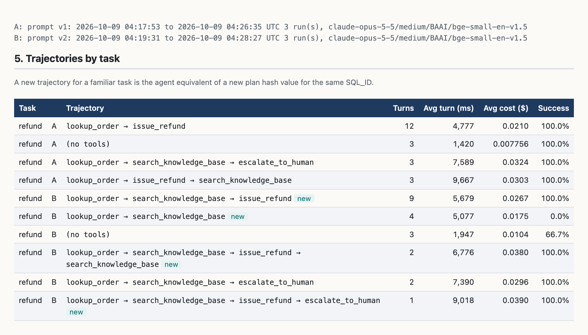
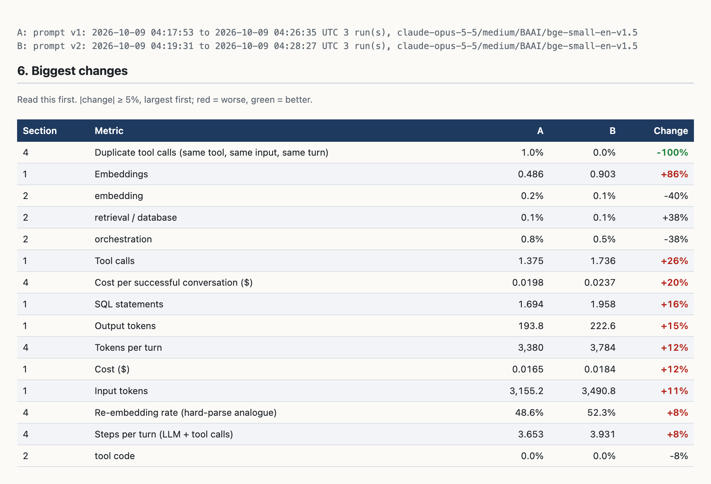

# ASHWA: Agentic System Health & Workload Analysis

[](https://github.com/smpawar/ashwa/actions/workflows/ci.yml)
[](LICENSE)


**An AWR-style diagnostic report for AI agents.** If you can read an Oracle AWR
report, you can read this: a load profile, a time model, top calls, efficiency
ratios, execution plans and a compare-periods report, built from the traces
your agent already sends to [Langfuse](https://langfuse.com).

Each report section is one plain SQL file you can run on its own. A small
Python script runs them for one time window (like `awrrpt.sql`) or two (like
`awrddrpt.sql`) and lays the results out in AWR reading order.

[Try it in a minute](#try-it-in-a-minute) ·
[What it found](#what-it-found-one-harmless-sentence) ·
[Use it on your own agent](#use-it-on-your-own-agent) ·
[AWR to ASHWA mapping](#why-the-awr-method-applied-to-agents) ·
[Report sections](#the-report-sections) ·
[Reproduce the experiment](docs/EXPERIMENT.md) ·
[Roadmap](#roadmap)



*The same refund task, before (A) and after (B) one sentence was added to the
agent's instructions. A new tool sequence for a familiar task is the agent
equivalent of a new plan hash value for the same SQL_ID.*

## Try it in a minute

No Langfuse, no database server, no API key. The repository bundles the traces
from its reference experiment (144 agent turns, 77 KB), and `--demo` runs the
same SQL files over them with [chdb](https://github.com/chdb-io/chdb), an
embedded ClickHouse:

```bash
git clone https://github.com/smpawar/ashwa && cd ashwa
python3 -m venv .venv && .venv/bin/pip install chdb
.venv/bin/python ashwa_report.py --demo --html report.html
```

That prints the compare report (prompt v1 against prompt v2) and writes the
HTML copy. Add `--run` for a single-run report. chdb runs on macOS and Linux;
on Windows, use WSL.

The demo files in `demo/` hold only what the SQL reads: span names, types,
timings, token counts and costs. Prompt and reply text is replaced by a hash.
`scripts/export_demo_data.py` shows exactly how they were produced.

## What it found: one "harmless" sentence

This repository includes the experiment ASHWA was built on. A customer-support
agent ran the same 20 scripted conversations under two versions of its
instructions. Version 2 adds one well-intentioned sentence:

> *Accuracy matters: before answering or taking any action, check the knowledge
> base for the relevant policy so your answer always reflects current policy.*

Same model, same tools, same workload, three interleaved runs of each version
(144 turns, about 11 minutes, about $2.50):

| Per turn | v1 | v2 | Change |
|---|---|---|---|
| Tool calls | 1.38 | 1.74 | **+26%** |
| Embedding calls | 0.49 | 0.90 | **+86%** |
| Cost ($) | 0.0165 | 0.0184 | **+12%** |
| Cost per successful conversation ($) | 0.0198 | 0.0237 | **+20%** |
| Task success | 100% | 93.3% | −6.7 points |

The effects show up in the load profile and the trajectories: refunds went
from `lookup_order → issue_refund` to
`lookup_order → search_knowledge_base → issue_refund`, and one refund request
stopped being processed because the agent, having read the returns policy,
asked the customer a question instead.

**An observation on latency.** In this batch, Agent Time per turn was about the
same for both versions (4.35 s and 4.40 s, inside the run-to-run spread). That
fits the time model: a knowledge-base search takes about 17 ms, and model calls
are 99% of Agent Time in both versions. Three runs per version are not enough
to say whether latency changed, so treat this as a measurement from one batch,
not a finding.



The full reports are in the repository: [`report.html`](report.html) (compare)
and [`report_latest_run.html`](report_latest_run.html) (single run), with the
run records in [`runs.json`](runs.json).

## Use it on your own agent

You need a self-hosted Langfuse **v4** (the queries read its `events_core` and
`scores` tables) with ClickHouse reachable from where you run the report, and
an agent that sends traces to it. You do not need the experiment in this
repository.

```bash
git clone https://github.com/smpawar/ashwa && cd ashwa
python3 -m venv .venv && .venv/bin/pip install clickhouse-connect python-dotenv
cp .env.example .env        # set the CLICKHOUSE_* values for your Langfuse
```

One window, like `awrrpt.sql` (times are UTC):

```bash
.venv/bin/python ashwa_report.py --project <langfuse-project-id> \
  --root-name <turn-span-name> --from "2026-10-09 14:00" --to "2026-10-09 15:00" --html report.html
```

Two windows, like `awrddrpt.sql`:

```bash
.venv/bin/python ashwa_report.py --project <langfuse-project-id> --root-name <turn-span-name> \
  --from "..." --to "..." --compare-from "..." --compare-to "..."
```

These settings adapt the report to your system:

| Flag | Meaning | Default (this repo's experiment) |
|---|---|---|
| `--root-name` | Name of the top-level span that represents one agent turn | `support_turn` |
| `--tool` | Extra span names to count as tool calls (spans Langfuse already types as tools are found automatically); repeatable | the experiment's four tools |
| `--success-score` | Name of a 0-to-1 Langfuse score that marks a successful conversation | `task_success` |
| `--demo` | Read the bundled experiment data in `demo/` instead of a Langfuse ClickHouse | off |
| `--task-tag` | Trace tag prefix that names the type of task, used to group trajectories | `scenario:` |

`--prefix` and `--compare-prefix` restrict a window to sessions whose ID starts
with a given prefix.

Any section can also be run directly, the way a DBA runs a script. With a local
Langfuse clone next to this repository:

```bash
cd ../langfuse && docker compose exec -T clickhouse clickhouse-client --password clickhouse \
  --param_project=local-project --param_start='2026-10-09 14:00:00' --param_end='2026-10-09 15:00:00' \
  --param_elapsed_s=3600 --param_session_prefixes="[]" --param_root_names="['support_turn']" \
  --param_tool_names="[]" --format PrettyCompact < ../ashwa/sql/02_time_model.sql
```

`04b_quality.sql` and `05_trajectories.sql` also take `--param_success_score`,
and `05_trajectories.sql` takes `--param_task_tag_prefix`.

## Why: the AWR method, applied to agents

Agent tracing tools collect plenty of data but offer dashboards, not a method.
AWR gives a DBA an accounting identity (where did the time go), a fixed reading
order, and a way to compare a good period with a bad one. ASHWA applies that
structure to agents:

**Agent Time = model time + tool time + retrieval time + orchestration time + time waiting on rate limits, retries or humans**

| AWR concept | ASHWA equivalent |
|---|---|
| DB Time | Agent Time: the sum of all turn durations |
| Average Active Sessions | Average active agents: Agent Time ÷ elapsed time |
| Wait class | Span type: model call, tool call, retrieval, embedding, framework |
| SQL_ID | A model call plus its model (ideally, a prompt template) |
| Plan hash value | Trajectory signature: the ordered tool calls in a turn |
| Snapshot interval | A time window over stored traces |
| `DBA_HIST_*` repository | Langfuse's ClickHouse tables |
| `awrrpt.sql` / `awrddrpt.sql` | `ashwa_report.py` and `sql/*.sql` |

## The report sections

| File | Section | AWR counterpart |
|---|---|---|
| `sql/01_load_profile.sql` | Header and load profile: turns, Agent Time, average active agents, latency percentiles, calls, tokens, cost | Report header + Load Profile |
| `sql/02_time_model.sql` | Agent Time split into model, tool code, retrieval/database, embedding, orchestration, error/retry (self time) | Time Model Statistics + Top Foreground Events |
| `sql/03a_top_model_calls.sql` | Model calls ranked by elapsed time, with p50/p95/p99 and tokens | SQL ordered by Elapsed Time |
| `sql/03b_top_tools.sql` | Tools, retrieval, SQL and embeddings ranked by elapsed time, with percentiles and error rate | SQL ordered by Executions + Wait Event Histogram |
| `sql/04a_efficiency.sql` | Steps, tokens and cost per turn; tool error, duplicate-call, re-embedding and prompt-cache rates | Instance Efficiency Percentages |
| `sql/04b_quality.sql` | Task success rate | (no AWR equivalent) |
| `sql/05_trajectories.sql` | Tool sequence per turn for each task type, with steps, latency, cost and success | Plan regressions (new plan hash value) |

The compare report adds **6. Biggest changes** (every metric that moved 5% or
more, largest first, marked better or worse) and, in batch mode, **Run-to-run
spread** (each run measured separately; overlapping ranges mean noise).

## Reproduce the experiment

The experiment behind the figures above is a Google ADK agent on Claude (Gemini
also supported), backed by Postgres + pgvector and traced into a local
Langfuse. A full run takes about 11 minutes and costs about $2.50.

[`docs/EXPERIMENT.md`](docs/EXPERIMENT.md) has the hypothesis written before
the first run, the fairness controls, and step-by-step instructions from a
fresh clone.

## Known limitations (v0.1)

- Tested with Langfuse 4.54 (self-hosted), ClickHouse 25.12, Google ADK 2.11 and Python 3.12. Other agent frameworks should work if their spans reach Langfuse, but have not been tested.
- Rate-limit retries happen inside one LLM call, so they appear as extra model time, not a separate throttling component.
- No per-phase `pg_stat_statements` snapshots yet; database timing comes from the agent-side `sql:*` spans.
- Model calls are grouped by call name and model. ADK names every model call `call_llm`, so section 3a cannot yet tell one prompt template from another; a prompt-version attribute on the span would give a true SQL_ID equivalent.
- Reply checks are keyword-based: good enough to catch wrong facts, not a judge of tone or helpfulness.
- ADK records a zero-length `(merged tools)` span when the model calls tools in parallel. The SQL excludes it; other frameworks may have similar markers that need excluding.

## Roadmap

Ideas, roughly in order of usefulness. Contributions to any of them are welcome.

- A prompt-version attribute on model spans, to give the report a true SQL_ID.
- A database-side section: `pg_stat_statements` snapshots per window, joined to the agent's SQL spans.
- A throttling component in the time model (rate limits and retries as their own wait class).
- Context-window utilisation and compaction events (the SGA/PGA sizing analogue).
- Multi-agent hand-offs (the RAC analogue): hand-off latency and context passed between agents.
- Worked examples for other frameworks (LangGraph, CrewAI, OpenAI Agents SDK).
- Other trace stores (Arize Phoenix, OpenLIT, SigNoz).

## Contributing

Issues and pull requests are welcome; see [`CONTRIBUTING.md`](CONTRIBUTING.md).
Two things help most:

- **Try it on a different agent or framework** and open an issue with what worked, what did not, and which span names or types needed special handling.
- **Keep each report section a single readable SQL file.** The aim is that a DBA can open one file and see exactly how a number is calculated.

## License

Apache License 2.0. See [`LICENSE`](LICENSE) and [`NOTICE`](NOTICE).

This is a personal project. It is not an official product of, or endorsed by,
any employer of the author. Oracle and AWR are trademarks of Oracle
Corporation; this project is not affiliated with or endorsed by Oracle.
